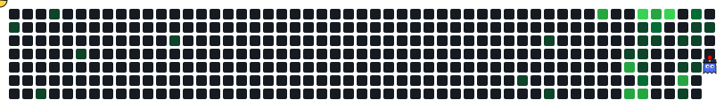
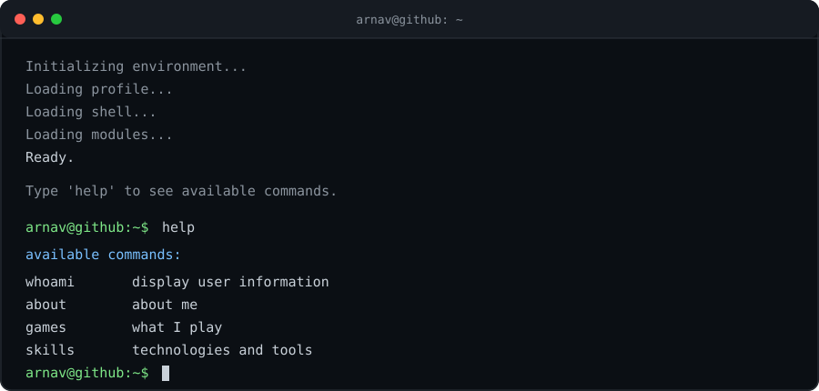

<h1 align="center">Hi, I'm Arnav Joshi</h1>

  Computer Science Student · Aspiring Developer · Gamer

  

<h2 align="center">Tech Stack</h2>

  

  Second-year student at PES University, passionate about coding, gaming
  and watching movies. Always curious to learn something new and build
  cool projects along the way.

<h2 align="center">Currently Exploring</h2>

  Python for Automation & Data Projects · Databases & SQL

<h2 align="center">Interactive Terminal</h2>

  

  Click the terminal to open the interactive version.

<h2 align="center">Connect</h2>

  
  &nbsp;&nbsp;&nbsp;&nbsp;&nbsp;&nbsp;
  
  &nbsp;&nbsp;&nbsp;&nbsp;&nbsp;&nbsp;
  

  Learning to code one line at a time.

